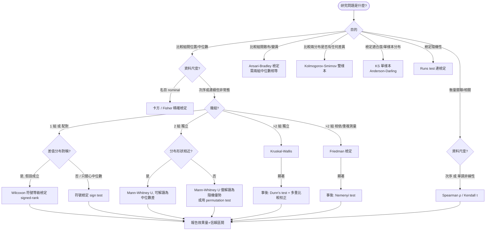

# 無母數方法選擇決策樹

## 節點判斷規則

| 判斷點 | 問法 | 分支 |
|---|---|---|
| 目的 | 想回答什麼問題? | 比較 / 相關 / 適合度 / 隨機性 |
| 資料尺度 | 反應變數是什麼尺度? | 名目→卡方類；次序或連續非常態→無母數等級法 |
| 樣本結構 | 幾組?組間獨立還是同一批受試者? | 1/配對、2 獨立、>2 獨立、>2 相依 |
| 形狀假設 | 兩組分布形狀是否相近? | 相近→可談中位數差；不相近→只能談隨機優勢 |
| 對稱假設 | 配對差值分布是否對稱? | 對稱→signed-rank；不確定→sign test |

## 方法對照（母數 ↔ 無母數）

| 情境 | 母數方法 | 無母數對應 |
|---|---|---|
| 單樣本/配對 | paired t-test | Wilcoxon signed-rank / sign test |
| 兩獨立樣本(位置) | independent t-test | Mann-Whitney U |
| 兩獨立樣本(散布) | F-test / Levene | Ansari-Bradley |
| 多組獨立 | one-way ANOVA | Kruskal-Wallis |
| 多組相依 | repeated-measures ANOVA | Friedman |
| 相關 | Pearson r | Spearman ρ / Kendall τ |

> 每個方法的完整假設、統計量、ties 處理、判斷規則與 R code 見 `textbook-methods.md`。
