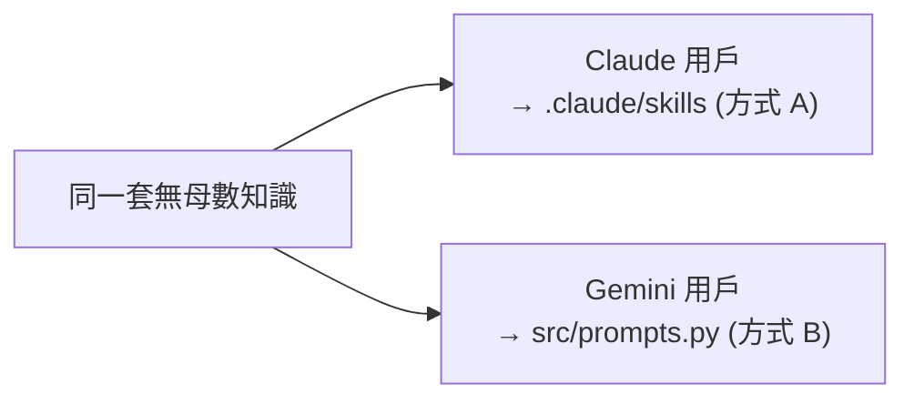

# 使用與維護指南

本專案用**兩種方式**交付同一套無母數統計知識：

| 方式 | 給誰 | 入口 | 要裝環境 / API key 嗎 |
|---|---|---|---|
| **A. Claude Agent Skill** | 用 Claude Code 的人（含非工程背景者） | `.claude/skills/nonparametric-stats/` | 不用 |
| **B. Python Agent** | 想當獨立程式跑、或用 Gemini 的人 | `src/`（`python -m src.cli`） | 要（虛擬環境 + API key） |

兩邊的專業知識是刻意對齊的：**Claude 用戶走 A、Gemini 用戶走 B**。



---

## 一、Claude 用戶的使用方法（方式 A：Skill）

Skill 會在用 Claude Code 開啟本專案時**自動載入**，不需要任何程式或金鑰。

### 步驟
1. 先安裝 [Claude Code](https://www.anthropic.com/claude-code)（需要 Node.js）。
2. 取得專案並進入資料夾：
   ```bash
   git clone https://github.com/Utauorca/nonparametric-stats-agent.git
   cd nonparametric-stats-agent
   ```
3. 在這個資料夾內啟動 Claude Code：
   ```bash
   claude
   ```
   > ⚠️ 一定要先 `cd` 進資料夾**再**執行 `claude`，Claude Code 才會掃到 `.claude/skills/`。
4. （可選）輸入 `/skills` 確認清單裡有 `nonparametric-stats`。
5. 直接用自然語言發問，例如：
   > 我有兩組獨立樣本、每組 15 筆、資料不常態，想比較差異，該用什麼檢定？

   Claude 會偵測到關鍵字 → 自動套用 Skill → 照決策樹回答、說明假設、給效果量。

### 想全域使用（任何專案都能用）
把 Skill 複製到個人 skills 目錄：
```bash
cp -r .claude/skills/nonparametric-stats ~/.claude/skills/
```

---

## 二、Gemini 用戶的使用方法（方式 B：Python Agent）

Gemini 無法使用 `SKILL.md`（那是 Claude 專屬機制），但可以透過本專案的 Python agent，
其系統提示 `src/prompts.py` 與 Skill 內容一致。

### 步驟
1. 安裝 Python 套件：
   ```bash
   python -m venv .venv
   # Windows:
   .venv\Scripts\activate
   # macOS / Linux:
   source .venv/bin/activate
   pip install -r requirements.txt
   ```
2. 設定金鑰：複製 `.env.example` 成 `.env`，填入
   ```
   LLM_PROVIDER=gemini
   GEMINI_API_KEY=你的金鑰
   ```
   （金鑰申請：<https://aistudio.google.com/apikey>，有免費額度。）
3. 啟動：
   ```bash
   python -m src.cli
   ```
   （Windows 也可對 `run.bat` 點兩下。）
4. 直接發問即可；輸入 `/reset` 重開一段諮詢、`/exit` 離開。

> Claude 用戶也可以走這條路：把 `.env` 改成 `LLM_PROVIDER=claude` + `ANTHROPIC_API_KEY`。
> 差別只在「要不要自己管程式與金鑰」。

### ChatGPT 用戶？
目前 `src/agent.py` 只內建 Gemini 與 Claude 兩個後端，**尚未支援 OpenAI**。
想用 ChatGPT 有兩條路：
- 不寫程式：到 ChatGPT 建一個 **Custom GPT**，把 `.claude/skills/nonparametric-stats/SKILL.md`
  與 `references/` 的內容貼進 Instructions。
- 寫程式：在 `src/agent.py` 新增 `LLM_PROVIDER=openai` 分支（系統提示可共用 `prompts.py`）。

---

## 三、想更動專業知識或步驟？從哪裡改

**最重要的觀念：知識有兩份來源，改一邊要同步另一邊**，否則 Claude 版與 Gemini 版會不一致。

| 來源 | 檔案 | 服務對象 |
|---|---|---|
| Skill 側 | `.claude/skills/nonparametric-stats/`（`SKILL.md` + `references/` + `scripts/`） | Claude 用戶（方式 A） |
| Python 側 | `src/prompts.py` | Gemini / Claude 用戶（方式 B） |

### 對照表：想改什麼 → 動哪個檔

| 想做的事 | Skill 側改這裡 | Python 側改這裡 |
|---|---|---|
| **改回答風格 / 流程 / 要問的判斷點** | `SKILL.md` 本體 | `prompts.py` 的「回答流程」「溝通風格」段 |
| **改 Skill 的觸發時機（哪些問題會啟動）** | `SKILL.md` 的 `description`（關鍵字寫滿） | 不適用（Python agent 一律啟動） |
| **改方法選擇邏輯（決策樹）** | `references/decision-tree.md` | `prompts.py` 的「決策樹」段 |
| **改某個檢定的假設 / 公式 / ties / R code** | `references/textbook-methods.md`（完整版）或 `references/methods.md`（速查） | `prompts.py` 的「各方法詳解」段 |
| **新增一個檢定** | 在 `references/` 補內容 + 在 `SKILL.md` 提一句 | 在 `prompts.py` 「專業範圍」「決策樹」「各方法詳解」各補一段 |
| **改實際計算的程式（算 p 值的方式）** | `scripts/run_test.py` | `src/tools.py`（`run_python` 等工具） |

### 各檔案一句話職責
- `SKILL.md` — Skill 的大腦：`description`（觸發開關）+ 本體（回答流程與指路標）。
- `references/decision-tree.md` — 「該用哪個檢定」的決策樹（mermaid 流程圖 + 規則表）。
- `references/methods.md` — 各檢定的簡短速查（統計量、ties、scipy 函式）。
- `references/textbook-methods.md` — 各檢定的完整版（嚴謹假設、公式、大樣本近似、R code；底本 Hollander 2015）。
- `scripts/run_test.py` — 用 scipy 真算 p 值的腳本（避免模型憑空給數字）。
- `src/prompts.py` — Python agent（Gemini/Claude）的系統提示，內容與上面對齊。
- `src/agent.py` — 核心邏輯：依 `LLM_PROVIDER` 切換後端、管理對話、掛工具。
- `src/tools.py` — Python agent 的工具：`read_file` / `run_python` / `write_file`。

### 建議的修改流程
1. 先改**一邊**（例如 Skill 的 `references/textbook-methods.md`）。
2. 把同樣的變動**同步**到另一邊（`src/prompts.py` 對應段落）。
3. 測試：
   - Claude 側 → 用 Claude Code 開專案，問一題看行為對不對。
   - Gemini 側 → `python -m src.cli` 問同一題，確認答案一致。
4. commit 時在訊息註明「兩邊已同步」，方便日後追蹤。

> 若覺得維護兩份很麻煩，可考慮讓 `prompts.py` 啟動時直接讀取 `references/*.md`，
> 做到「單一真相來源」。這需要改 `prompts.py` 的載入方式，屬進階選項。
